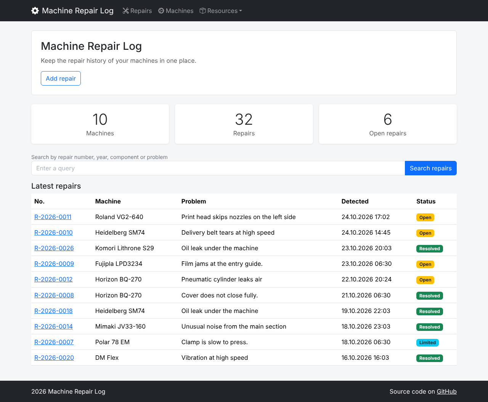
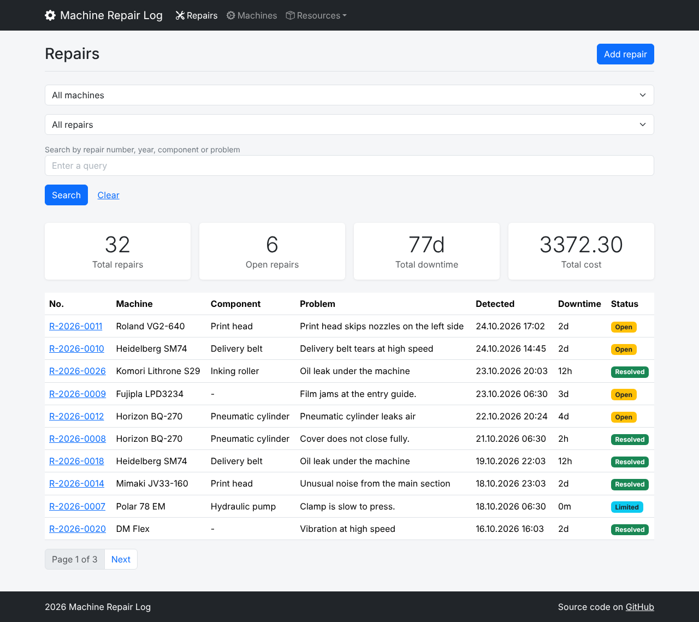
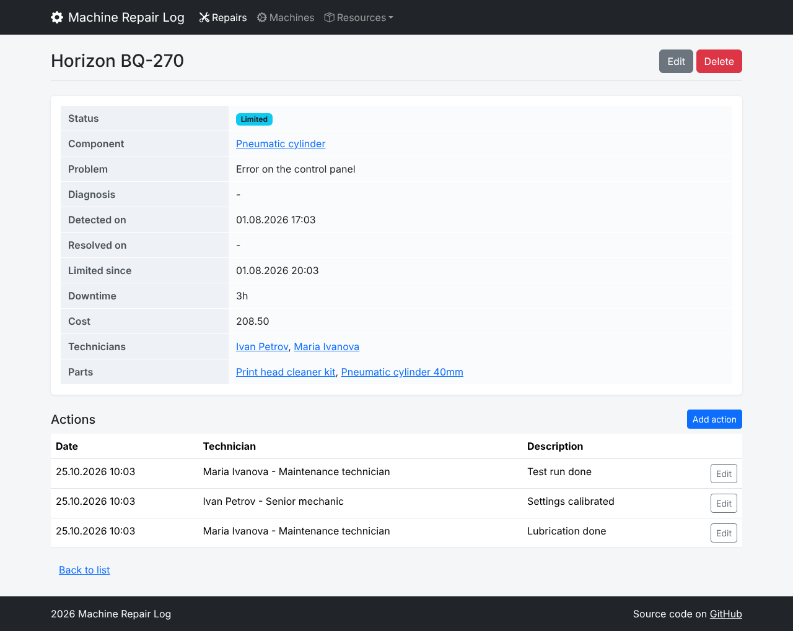
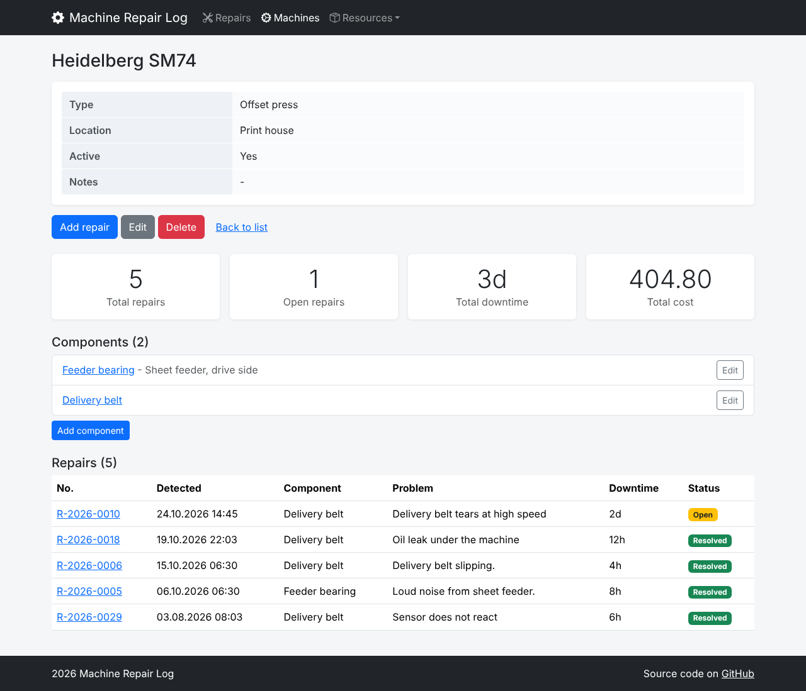
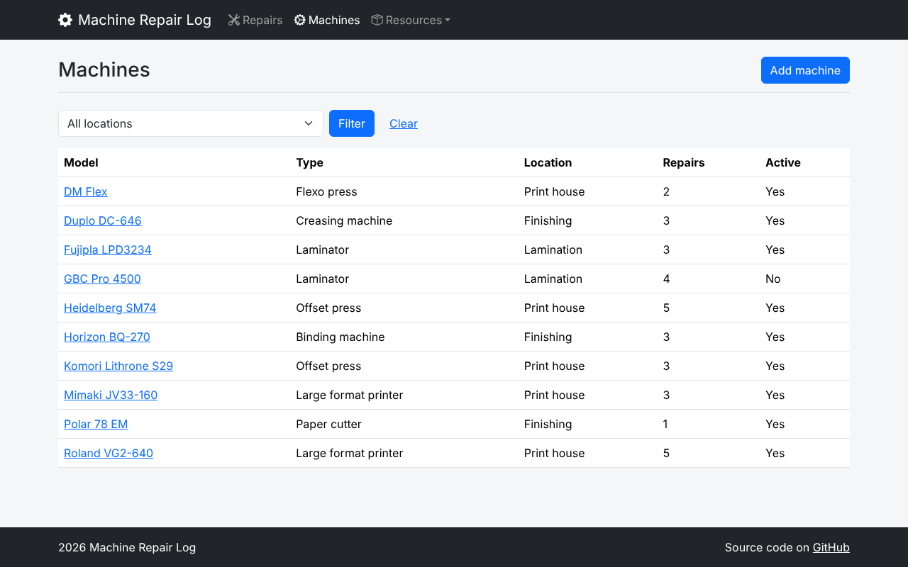

# Machine Repair Log

A Django web app for logging breakdowns and repairs of production machines. Maintains a full repair history per machine and component, tracks downtime and repair costs and links each repair to the technician who did it and the spare parts used.

The idea came from a real need for a flexographic packaging printing house, where the repair log was stored in a spreadsheet.

## Features

- Machines and components: register machines and their components (main motor, print head, delivery belt etc) each with their own repair history.
- Repairs: log a breakdown with problem description, diagnosis, date of detection, cost, photo, technicians and parts used.
- Repair status: each repair is automatically shown as Open, Limited (the machine runs with limitations) or Resolved. This is based on the dates.
- Downtime is calculated automatically from the date of detection until the machine runs again (either limited or resolved). For open repairss it keeps growing.
- Auto-generated repair numbers in the format R-2026-0007 (year of detection plus repair ID).
- Repair actions: a timeline of the work carried out on each repair and by which technician.
- **Search and filters in the repairs list:**
  - filter by machine and by status;
  - search by repair number, component or problem:
    - `R-2026-0007`: one specific repair
    - `R-2026`: all repairs from 2026
    - free text, for example `bearing`: matches the problem or component
- Search stats: total repairs, open repairs, total downtime and total cost are all calculated for the current search result.
- Machine statistics: the same summary for each machine and component on their details pages.
- Location filter in the machines list.
- Repair history protection: a machine that has had repairs on it cannot be deleted, the user simply gets a message to that effect.
- Quick links from a repair to its component, its technician and its parts.
- Resources: technicians, suppliers and spares with full CRUD.
- **Custom 404 page.**

## Screenshots

### Home page


### Repairs list with filters and statistics


### Repair details


### Machine details with statistics and repair history


### Machines list with location filter



## Installation and running

1. Clone the repository:

   ```bash
   git clone https://github.com/spv8bs/machine-repair-log.git
   cd machine-repair-log
   ```

2. Make a virtual environment and turn it on.

   **Windows**
   ```bash
   python -m venv .venv
   .venv\Scripts\activate
   ```

   **mac OS / Linux**
   ```bash
   python3 -m venv .venv
   source .venv/bin/activate
   ```

3. Install the dependencies:

   ```bash
   pip install -r requirements.txt
   ```

4. Apply the migrations:

   ```bash
   python manage.py migrate
   ```

5. Start the development server:

   ```bash
   python manage.py runserver
   ```

6. Open http://127.0.0.1:8000/ in your browser.

The app starts with an empty database. All objects can be created via the UI. No admin interface & no superuser required.

## Environment variables

**No environment variables are required.** It uses SQLite and runs with the defaults.

## Testing the custom 404 page

Django will show its own debug page when DEBUG is True. To see the custom 404 page you need to temporarily change in MachineRepairLog/settings.py:

```python
DEBUG = False
ALLOWED_HOSTS = ['*']
```

Then run the server with `--insecure`, so static files are still served:

```bash
python manage.py runserver --insecure
```

Open any URL that does not exist, for example, http://127.0.0.1:8000/does-not-exist/.

## Quick test scenario

The database is empty to start with. The steps below will create one object of each type and will show all the repair statuses in a matter of minutes. The example values are just that, suggestions.

1. Machines → Add machine: model 'Heidelberg SM74', type 'Offset press', location 'Print house'
2. Open the machine. **Add component:** `Delivery belt`
3. Resources > Technicians > Add Technician: Ivan Petrov, position: Mechanic
4. **Resources, Suppliers, Add supplier:** `TechParts Ltd`
5. Resources > Parts > Add part: Drive belt B45 (catalogue no. DB-B45), price 18.20, supplier TechParts Ltd
6. Open the machine → **Add repair:** component 'Delivery belt', problem 'Belt slipping', select the technician and the part. The repair is **Open** and its downtime continues to increase.
7. Open the repair → **Add action:** 'Removed the guard and inspected the belt'
8. Edit the repair and set 'Limited since': the status will become 'Limited' and the downtime will cease.
9. Edit it again and set Resolved on: the status then becomes Resolved.
10. Repairs: use the status filter and search for 'R-2026' or 'belt'; the stats at the top of the table are those for the search result.

## Project structure

```
MachineRepairLog/     project settings and root URLs
common/               home page, shared mixins, utils and the custom template filter
machines/             machines and components
repairs/              repairs and repair actions, search and filters
resources/            technicians, suppliers and parts
templates/            base template, partials and page templates per app
static/css/           custom styles
```

- A machine with repairs on it cannot be deleted (PROTECT), so the repair history is never lost.
